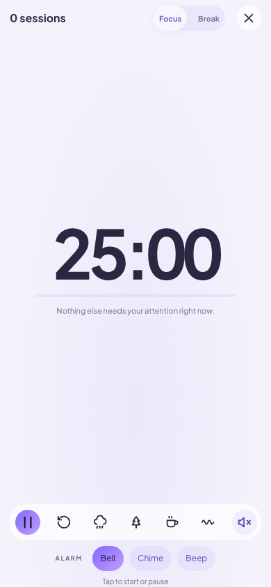
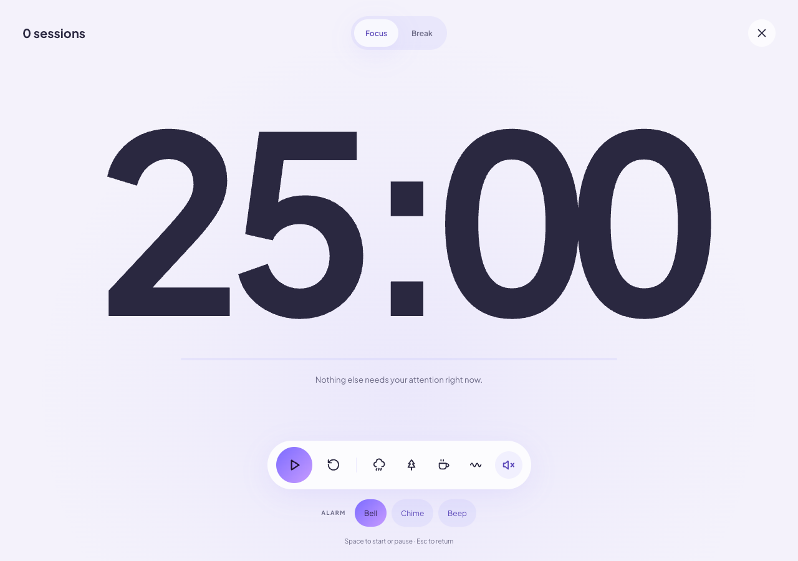

# Device-aware UI

- `useInput.ts` follows the supplied hook implementation exactly: a MutationObserver for html[data-input], useSyncExternalStore, matchMedia subscriptions, compact and standalone queries. Existing app-start input tracker remains the single source of input mode.
- Small InputHint components replace timer help, completion dialog help and the reader onboarding keyboard hint. Keyboard branches retain .kbd-hint fallback styling. Touching the full-screen clock starts/pauses it; Space/Esc retain the existing input-mode gating.
- Settings contains a small touch-only Share/Home Screen helper. Share requires navigator.share. Home Screen guidance is suppressed in standalone mode, persisted on dismissal and marked seen in sessionStorage before display. Layout visibility remains CSS-controlled at phone widths.
- Reader paging observes passive touch events; a horizontal gesture of at least 70px within 600ms turns pages. Vertical movement over 14px, multi-touch, active text selection, selection changes, controls and touchcancel cancel the gesture. It never calls preventDefault or changes touch-action. Listeners are cleaned up on unmount, stage changes and opening reader panels. No large reader tree subscribes to input hooks.
- No navigator.userAgent/navigator.platform references exist in app source.

Validation: 17 Node unit tests pass, Vite production build passes. Browser emulation checks live touch/keyboard hint changes without replacing the timer DOM, touch/desktop timer screenshots, Share supported/unsupported, dismissal persistence and standalone suppression. These are Chromium emulation checks, not real iOS OS-share or installation tests.

